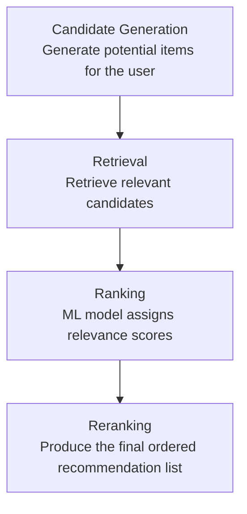

# recommendation-ranking-model
A machine learning project exploring recommendation ranking, evaluation, and model explainability.


# Recommendation Ranking Model

A practical machine learning project focused on building a recommendation ranking pipeline, from candidate generation and retrieval to ranking and reranking.

## Objective

Build and evaluate a recommendation ranking system that ranks candidate items for a user or query using machine learning.

## Problem Statement

## Architecture

The recommendation ranking pipeline follows four main stages:



### Pipeline Overview

- **Candidate Generation:** Generate a set of potential items that could be recommended to a user.
- **Retrieval:** Retrieve relevant candidates for the user.
- **Ranking:** Use a machine learning model to assign relevance scores and rank the candidates.
- **Reranking:** Apply the final ranking logic to produce the ordered recommendation list.

**Current status:** Architecture documented; implementation not started.

### What Is Being Ranked?

The system ranks a set of candidate items that could potentially be recommended to a user.

### For Whom?

The ranking is performed for individual users based on available user, item, and interaction features, such as user preferences, historical interactions, and item characteristics.

### Why Rank Them?

A recommendation system may retrieve multiple candidate items, but not all candidates are equally relevant to the user. The goal of the ranking stage is to assign a relevance score to each candidate and order them so that the most relevant items appear higher in the recommendation list.

### Objective

Build a machine learning-based ranking system that learns from user-item interaction data and ranks candidate items according to their predicted relevance to the user.

The project will focus on comparing a baseline ranking approach with an XGBoost-based ranking model and evaluating ranking quality using metrics such as NDCG and MRR.

## Planned Pipeline

Candidate Generation → Retrieval → Feature Engineering → Ranking Model → Reranking → Evaluation

## Planned Components

- Data exploration and preprocessing
- Feature engineering
- Baseline ranking approach
- XGBoost ranking model
- Ranking evaluation using NDCG and MRR
- MLflow experiment tracking
- SHAP-based model analysis
- FastAPI `/rank` endpoint

## Current Status

🚧 Project setup — implementation not started.

## Repository Structure

```text
recommendation-ranking-model/
├── README.md
├── TASKS.md
└── .gitignore
```

## Important Note

This is a personal portfolio project. It does not contain proprietary code, data, or confidential information from any employer or client.

The components listed above are planned work, not completed features.


## Dataset and Data Limitations

### Dataset Selection

This project will use a publicly available recommendation dataset to develop and evaluate a machine learning-based ranking system.

The dataset will be selected based on its suitability for modeling user-item interactions, defining relevance labels, and evaluating ranking quality.

**Current status:** Dataset selection is planned but not yet completed.

### Expected Data Structure

The dataset should support the following components:

- **Users:** Identifiers or attributes representing users.
- **Items:** Identifiers or attributes representing recommended items.
- **Interactions:** User-item interactions, such as ratings, clicks, views, or purchases, depending on the selected dataset.
- **Relevance labels:** Signals used to determine how relevant an item is to a user or recommendation context.

The actual schema and available features will depend on the selected dataset.

### Potential Data Limitations

The following limitations will be investigated after dataset selection. They have not yet been confirmed.

1. **Limited user information:** Insufficient user attributes may prevent the model from fully capturing individual preferences.
2. **Sparse interactions:** Users may interact with only a small subset of available items, limiting preference information.
3. **Cold-start problem:** New users or items may lack sufficient interaction history.
4. **Implicit feedback limitations:** Clicks and views do not necessarily indicate positive interest.
5. **Popularity bias:** Frequently interacted-with items may dominate recommendations.
6. **Temporal limitations:** Historical interactions may not represent current preferences.
7. **Data leakage:** Some features or records may reveal information unavailable at prediction time.
8. **Generalizability:** Results on one dataset may not transfer directly to other domains or production environments.

These are potential limitations, not confirmed findings. Their actual presence and impact will be assessed during exploratory data analysis.

### Data Quality and Validation Plan

After selecting the dataset, the project will:

- Inspect the schema and understand each field.
- Check missing values, duplicate records, and inconsistent data types.
- Analyze user, item, and interaction distributions.
- Investigate interaction sparsity and item popularity.
- Define an appropriate relevance-labeling strategy.
- Check for data leakage.
- Design a suitable train-validation-test split.
- Document assumptions and confirmed limitations.

### Impact on Ranking Evaluation

Dataset quality and relevance-label design directly affect ranking evaluation.

**Normalized Discounted Cumulative Gain (NDCG)** and **Mean Reciprocal Rank (MRR)** will be considered to evaluate ranking quality once the dataset and evaluation methodology have been established.

No performance results will be reported until the model has been implemented and evaluated.

### Scope and Limitations

This is a personal portfolio project using public data. Its results will demonstrate performance on the selected dataset and evaluation setup; they will not guarantee similar performance in a production recommendation system.

No proprietary company or client data will be used.


## Evaluation Methodology

### Objective

The objective of evaluation is to determine whether the recommendation ranking model places relevant items higher in the ranked results.

The project will establish a baseline ranking approach and compare it with an XGBoost ranking model using appropriate ranking metrics.

### Baseline Ranking Approach

A baseline provides a reference point for measuring whether a more advanced ranking model improves recommendation quality.

The initial baseline will use **item popularity**, measured using interaction counts from the training data. Candidate items will be ranked by their popularity scores.

The baseline and trained model will be evaluated using the same test requests, candidate items, relevance labels, and ranking metrics wherever possible.

**Status:** Planned. Implementation and evaluation have not started.

### Normalized Discounted Cumulative Gain (NDCG)

NDCG evaluates a ranked list by considering both the relevance of items and their positions. Highly relevant items appearing near the top contribute more to the score.

NDCG is particularly useful when relevance labels have multiple levels, such as ratings of 1–5 or graded relevance labels.

**Interpretation:**

- A score closer to 1 indicates a ranking closer to the ideal ordering under the chosen evaluation setup.
- A lower score indicates that relevant items may be ranked less effectively.
- NDCG accounts for the positions of relevant items throughout the evaluated list.

The project will select an appropriate cutoff, such as NDCG@5 or NDCG@10, based on the recommendation use case.

### Mean Reciprocal Rank (MRR)

MRR measures how highly the first relevant item appears in a ranked list.

For a single recommendation request, the reciprocal rank is calculated as:

`Reciprocal Rank = 1 / Rank of the First Relevant Item`

Examples:

- First relevant item at rank 1: score = 1.0
- First relevant item at rank 2: score = 0.5
- First relevant item at rank 3: score ≈ 0.333
- No relevant item found: score = 0

MRR is the average reciprocal rank across all evaluated requests.

**Interpretation:**

- A score closer to 1 indicates that the first relevant item generally appears near the top.
- A lower score indicates that users may need to look further down the list to find a relevant item.
- MRR focuses on the first relevant result, rather than the quality of every item in the list.

The definition of relevance and the treatment of requests with no relevant items will be documented as part of the evaluation methodology.

### Evaluation Dataset and Data Splitting

The dataset will be divided into training, validation, and test sets using a strategy appropriate for the selected data.

- **Training set:** Used to train the ranking model and calculate training-derived features.
- **Validation set:** Used for model selection and hyperparameter tuning.
- **Test set:** Reserved for final evaluation after model development.

Where timestamps are available and suitable, a temporal split may be used to evaluate recommendations against future interactions.

Popularity scores and other features must not use information from the evaluation period. Data leakage will be checked before interpreting the results.

### Model Comparison

The project will compare two approaches:

1. **Popularity baseline:** Ranks candidate items using interaction counts from the permitted training data.
2. **XGBoost ranking model:** Uses engineered user, item, and interaction features to learn a ranking function.

Both approaches will be evaluated using the same test requests, candidate sets, and relevance labels wherever possible.

The comparison will include NDCG@K and MRR, together with ranking-error analysis and documented dataset limitations.

### What the Numbers Mean

The evaluation results will help answer the following questions:

- Does the XGBoost ranking model outperform the popularity baseline?
- Does the model place highly relevant items closer to the top?
- Does the model improve the position of the first relevant item?
- Are improvements consistent across different recommendation requests?
- Which ranking errors and limitations remain?

For example, if a baseline achieves NDCG@10 of 0.60 and the model achieves 0.70, the model has an absolute improvement of 0.10, or 10 percentage points on the metric's 0–1 scale.

The relative improvement would be approximately 16.7%. These numbers are illustrative only and are not results from this project.

A higher metric score does not automatically establish a better user experience. Offline evaluation measures performance against the available dataset and relevance labels. Online experiments may be required to establish real-world impact.

### Current Evaluation Status

**Status:** Evaluation methodology documented; implementation and evaluation are pending.

NDCG, MRR, baseline scores, and model comparison results will be reported only after implementation and evaluation.

No performance improvement is claimed at this stage.


## Reproducibility and Setup

### Prerequisites

The project is planned to use the following tools and technologies:

- Python for data processing and model development.
- Pandas and NumPy for data manipulation.
- Scikit-learn for preprocessing and supporting ML utilities.
- XGBoost for the ranking model.
- MLflow for experiment tracking.
- FastAPI for exposing the ranking model through an API.
- Uvicorn for running the API server.
- Git for version control.

Exact package versions and system requirements will be documented after the implementation environment has been established and tested.

### Project Environment

The project will use a Python virtual environment to isolate dependencies and improve reproducibility.

The following commands are planned for a Windows environment.

Create the project directory and navigate into it:

```bash
mkdir recommendation-ranking-model
cd recommendation-ranking-model
```

Create a virtual environment:

```bash
python -m venv .venv
```

Activate the environment in Windows Command Prompt:

```bash
.venv\Scripts\activate
```

Activate the environment in PowerShell:

```powershell
.\.venv\Scripts\Activate.ps1
```

The Python version will be selected based on compatibility with the final dependency versions.

### Install Dependencies

Once the dependency list has been established, install the project requirements using:

```bash
pip install -r requirements.txt
```

The `requirements.txt` file will contain the project's required Python packages and compatible versions.

After the environment has been tested, dependency versions will be pinned or locked to help reproduce the same environment.

### Dataset Setup

The project will use a publicly available recommendation dataset.

After selecting the dataset, the README will document:

- The original dataset source.
- Download instructions.
- Applicable license and usage restrictions.
- Expected directory structure.
- Required preprocessing steps.
- Data schema and relevance-label definitions.

Dataset files will not be committed to GitHub unless their license explicitly permits redistribution and the files are appropriate for repository storage.

### Training the Ranking Model

The project will eventually provide a training script that prepares the ranking data, trains the XGBoost ranking model, and records the relevant evaluation metrics.

The planned command is:

```bash
python src/train.py
```

The final implementation will document the required input data, configuration parameters, model output location, and experiment-tracking behavior.

**Status:** Planned — the training script has not been implemented or tested.

### Running the Ranking API

The project will expose the ranking functionality through a FastAPI endpoint.

The planned API startup command is:

```bash
uvicorn src.api:app --reload
```

Once implemented, the API will provide an endpoint such as:

```text
POST /rank
```

The endpoint will accept a recommendation request and candidate items, apply the trained ranking model, and return the candidates ordered by predicted ranking scores.

The final request and response schemas will be documented after implementation.

The interactive API documentation will be available at:

```text
http://127.0.0.1:8000/docs
```

This URL will be usable when the API server has been implemented and started successfully.

### Reproducibility Strategy

The project will follow these practices to support reproducible experiments:

- Use a documented Python environment and dependency versions.
- Keep data preprocessing consistent between training and inference.
- Use fixed random seeds where applicable.
- Document dataset sources, splits, and relevance-label definitions.
- Record model parameters and evaluation metrics.
- Track experiments using MLflow.
- Save model artifacts and configuration details.
- Document known limitations and any differences between runs.

Reproducibility does not guarantee identical results across every hardware configuration or software environment. Relevant version, hardware, and numerical differences will be documented when necessary.

### Current Status

**Status:** Reproducibility documentation drafted; implementation and execution are pending.

All commands in this section are planned examples. They must be validated against the final repository structure and actual implementation before being presented as tested instructions.
