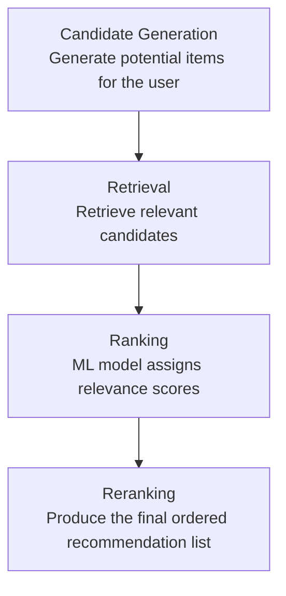

# recommendation-ranking-model
A machine learning project exploring recommendation ranking, evaluation, and model explainability.


# Recommendation Ranking Model

A practical machine learning project focused on building a recommendation ranking pipeline, from candidate generation and retrieval to ranking and reranking.

## Objective

Build and evaluate a recommendation ranking system that ranks candidate items for a user or query using machine learning.

## Problem Statement

## Architecture

The recommendation ranking pipeline follows four main stages:



### Pipeline Overview

- **Candidate Generation:** Generate a set of potential items that could be recommended to a user.
- **Retrieval:** Retrieve relevant candidates for the user.
- **Ranking:** Use a machine learning model to assign relevance scores and rank the candidates.
- **Reranking:** Apply the final ranking logic to produce the ordered recommendation list.

**Current status:** Architecture documented; implementation not started.

### What Is Being Ranked?

The system ranks a set of candidate items that could potentially be recommended to a user.

### For Whom?

The ranking is performed for individual users based on available user, item, and interaction features, such as user preferences, historical interactions, and item characteristics.

### Why Rank Them?

A recommendation system may retrieve multiple candidate items, but not all candidates are equally relevant to the user. The goal of the ranking stage is to assign a relevance score to each candidate and order them so that the most relevant items appear higher in the recommendation list.

### Objective

Build a machine learning-based ranking system that learns from user-item interaction data and ranks candidate items according to their predicted relevance to the user.

The project will focus on comparing a baseline ranking approach with an XGBoost-based ranking model and evaluating ranking quality using metrics such as NDCG and MRR.

## Planned Pipeline

Candidate Generation → Retrieval → Feature Engineering → Ranking Model → Reranking → Evaluation

## Planned Components

- Data exploration and preprocessing
- Feature engineering
- Baseline ranking approach
- XGBoost ranking model
- Ranking evaluation using NDCG and MRR
- MLflow experiment tracking
- SHAP-based model analysis
- FastAPI `/rank` endpoint

## Current Status

🚧 Project setup — implementation not started.

## Repository Structure

```text
recommendation-ranking-model/
├── README.md
├── TASKS.md
└── .gitignore
```

## Important Note

This is a personal portfolio project. It does not contain proprietary code, data, or confidential information from any employer or client.

The components listed above are planned work, not completed features.
