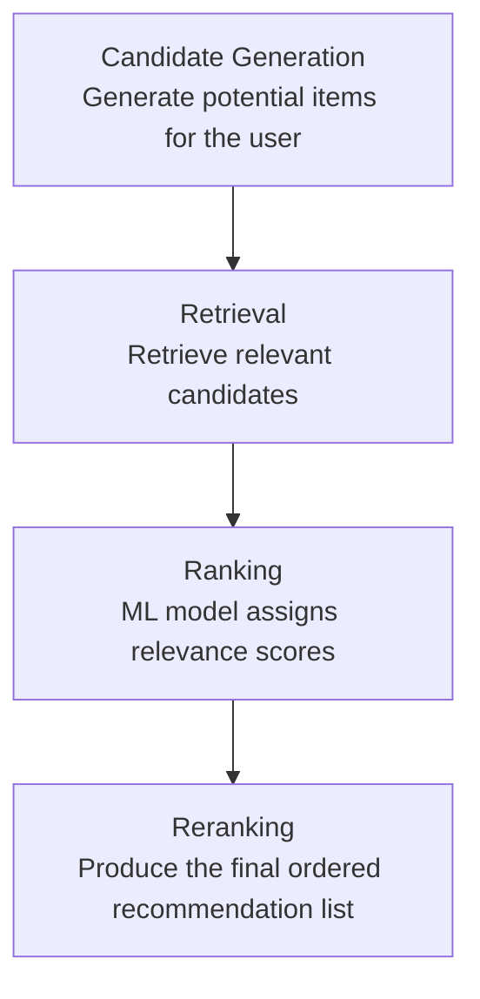

# recommendation-ranking-model
A machine learning project exploring recommendation ranking, evaluation, and model explainability.


# Recommendation Ranking Model

A practical machine learning project focused on building a recommendation ranking pipeline, from candidate generation and retrieval to ranking and reranking.

## Objective

Build and evaluate a recommendation ranking system that ranks candidate items for a user or query using machine learning.

## Problem Statement

## Architecture

The recommendation ranking pipeline follows four main stages:



### Pipeline Overview

- **Candidate Generation:** Generate a set of potential items that could be recommended to a user.
- **Retrieval:** Retrieve relevant candidates for the user.
- **Ranking:** Use a machine learning model to assign relevance scores and rank the candidates.
- **Reranking:** Apply the final ranking logic to produce the ordered recommendation list.

**Current status:** Architecture documented; implementation not started.

### What Is Being Ranked?

The system ranks a set of candidate items that could potentially be recommended to a user.

### For Whom?

The ranking is performed for individual users based on available user, item, and interaction features, such as user preferences, historical interactions, and item characteristics.

### Why Rank Them?

A recommendation system may retrieve multiple candidate items, but not all candidates are equally relevant to the user. The goal of the ranking stage is to assign a relevance score to each candidate and order them so that the most relevant items appear higher in the recommendation list.

### Objective

Build a machine learning-based ranking system that learns from user-item interaction data and ranks candidate items according to their predicted relevance to the user.

The project will focus on comparing a baseline ranking approach with an XGBoost-based ranking model and evaluating ranking quality using metrics such as NDCG and MRR.

## Planned Pipeline

Candidate Generation → Retrieval → Feature Engineering → Ranking Model → Reranking → Evaluation

## Planned Components

- Data exploration and preprocessing
- Feature engineering
- Baseline ranking approach
- XGBoost ranking model
- Ranking evaluation using NDCG and MRR
- MLflow experiment tracking
- SHAP-based model analysis
- FastAPI `/rank` endpoint

## Current Status

🚧 Project setup — implementation not started.

## Repository Structure

```text
recommendation-ranking-model/
├── README.md
├── TASKS.md
└── .gitignore
```

## Important Note

This is a personal portfolio project. It does not contain proprietary code, data, or confidential information from any employer or client.

The components listed above are planned work, not completed features.


## Dataset and Data Limitations

### Dataset Selection

This project will use a publicly available recommendation dataset to develop and evaluate a machine learning-based ranking system.

The dataset will be selected based on its suitability for modeling user-item interactions, defining relevance labels, and evaluating ranking quality.

**Current status:** Dataset selection is planned but not yet completed.

### Expected Data Structure

The dataset should support the following components:

- **Users:** Identifiers or attributes representing users.
- **Items:** Identifiers or attributes representing recommended items.
- **Interactions:** User-item interactions, such as ratings, clicks, views, or purchases, depending on the selected dataset.
- **Relevance labels:** Signals used to determine how relevant an item is to a user or recommendation context.

The actual schema and available features will depend on the selected dataset.

### Potential Data Limitations

The following limitations will be investigated after dataset selection. They have not yet been confirmed.

1. **Limited user information:** Insufficient user attributes may prevent the model from fully capturing individual preferences.
2. **Sparse interactions:** Users may interact with only a small subset of available items, limiting preference information.
3. **Cold-start problem:** New users or items may lack sufficient interaction history.
4. **Implicit feedback limitations:** Clicks and views do not necessarily indicate positive interest.
5. **Popularity bias:** Frequently interacted-with items may dominate recommendations.
6. **Temporal limitations:** Historical interactions may not represent current preferences.
7. **Data leakage:** Some features or records may reveal information unavailable at prediction time.
8. **Generalizability:** Results on one dataset may not transfer directly to other domains or production environments.

These are potential limitations, not confirmed findings. Their actual presence and impact will be assessed during exploratory data analysis.

### Data Quality and Validation Plan

After selecting the dataset, the project will:

- Inspect the schema and understand each field.
- Check missing values, duplicate records, and inconsistent data types.
- Analyze user, item, and interaction distributions.
- Investigate interaction sparsity and item popularity.
- Define an appropriate relevance-labeling strategy.
- Check for data leakage.
- Design a suitable train-validation-test split.
- Document assumptions and confirmed limitations.

### Impact on Ranking Evaluation

Dataset quality and relevance-label design directly affect ranking evaluation.

**Normalized Discounted Cumulative Gain (NDCG)** and **Mean Reciprocal Rank (MRR)** will be considered to evaluate ranking quality once the dataset and evaluation methodology have been established.

No performance results will be reported until the model has been implemented and evaluated.

### Scope and Limitations

This is a personal portfolio project using public data. Its results will demonstrate performance on the selected dataset and evaluation setup; they will not guarantee similar performance in a production recommendation system.

No proprietary company or client data will be used.
